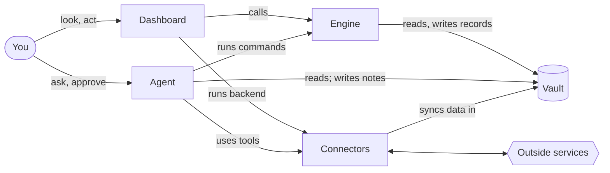

# VADE

VADE is a method for running personal projects together with an AI agent. Every project lives in one folder of plain files and git repos, the vault, and its work is split between four parts:

- **Vault:** the record. Plain files you can read, one folder per project.
- **Agents:** judgement. Claude, briefed for each project, with skills for its routines.
- **Dashboards:** seeing and acting. A live page per project with status, analysis and actions.
- **Engines:** fixed rules. One piece of code that gives you, the agent and the dashboard the same answer.

**Connectors** sit at the edge and link projects to outside services.

Say it "vayd", to rhyme with *made*. *Vade* is also Latin for "go", and a *vade mecum* ("go with me") is a handbook you keep at hand.

This repo describes the method. It contains no project data.

## Why

When a person and an AI agent work on the same projects, the same problems keep coming up:

- The agent starts every session from zero, or from an out-of-date picture.
- The chat says one number and the dashboard says another, because the rule was written twice.
- Data spreads across apps, and nobody knows which copy is right.
- The agent fills a gap with a guess, and the guess becomes a "fact".
- Automation does something that can't be undone.
- A background job stops, and nothing shows it.
- A backup path quietly takes over, and the broken one never gets fixed.

VADE fixes these by giving each kind of work one home and one owner.

## The model

| Part | Its job | What it holds | What it never does |
|---|---|---|---|
| **Vault** | Keeps the record and what's been learned | Logs, config, notes and briefings, as Markdown and JSON | Hold secrets, machine state, or two copies of one fact |
| **Agents** | Applies judgement: asks, interprets, decides what to record, does the busywork | A briefing and skills for each project | Edit records by hand, invent data, or take an irreversible step without you |
| **Dashboards** | Shows where things stand and offers the next actions | Nothing of its own. It reads the record and caches | Repeat a rule, write while drawing, or hide an error |
| **Engines** | Applies fixed rules: parses, checks, computes, prepares changes | Code only | Store what it can compute, or drop input it can't read |
| **Connectors** | Move data and actions between a project and outside services | Backend scripts, MCP servers and an encrypted credential | Hold project rules, or share a service with a second owner |



You look and act through the dashboard, and you talk to the agent. Both change records only through the engine, which reads and writes the vault. Connectors carry data and actions between the project and the outside world.

## Foundations

1. **One record, in plain text.** What a project knows lives once, in files a person can read and fix. Everything else is a view of it.
2. **One rulebook.** Every fixed answer comes from one piece of code, so you, the agent and the dashboard always agree.
3. **One owner for everything.** Every file, service, credential and background process has one writer. Everyone else reads.
4. **Judgement to the agent, rules to code, the final say to you.** The agent handles what needs thought. Code handles what has one right answer. You decide anything that can't be undone.
5. **Nothing fails silently.** Bad input, stale data, stopped processes and a waiting agent all show up where you look.
6. **Grow only what's needed.** A project starts as a folder with a repo and a dashboard, and gains each other part when it earns it.

## An example: a garden project

A made-up project that uses every part:

| Part | In the garden project |
|---|---|
| Vault | `<Vault>/Garden/` holds `garden-config.json` (each plant and how often it needs water), `Log/2026-09.md` (one line per watering) and `Knowledge/` (what worked, what didn't) |
| Agent | `CLAUDE.md` makes Claude the garden's assistant, says to read `Knowledge/Beds.md` first, and describes a weekly planning routine. A `plan-week` skill asks what's coming up and proposes a schedule |
| Dashboard | `garden-dashboard.ts` is the garden's page on the dashboard server. It shows what's due today (status), a watering heatmap (analysis), a "log watering" button (actions), and when the forecast last updated. `garden-dashboard.css` beside it is its styling |
| Engine | `engine.ts` parses the log and works out what's due. Its `status`, `add "watered basil"` and `check` commands work from the terminal, and the dashboard calls the same functions |
| Connector | A weather script pulls the forecast into a cache. The engine, not the script, decides to skip watering when rain is due |

Its contract, `api.json`, says what other projects may use: the `garden` command, and `@Garden:due`, today's watering list, which the home page shows without counting it again.

A day in the log looks like this:

```markdown
## 2026-09-10
- 07:30 watered tomatoes
- 07:32 watered basil
```

## The rules

The foundations are the method. The rules below are one way to apply them, with a folder of plain files, a small dashboard server on your own machine, and Claude Code. They're numbered so other files can refer to them.

### Vault: the record

#### 1. One home for all projects

All projects live in one folder of their own in your home folder: the vault, written `<Vault>` below. Each project is a folder directly inside it. There is one place to look for anything.

The vault is a plain folder, not an app's. Any editor opens its files, the agent reads them as files, and the dashboard server shows its notes as pages (rule 17).

The top of the vault is the home. It holds what every project shares, like the code loader (rule 44) and shared definitions (rule 27), and two indexes:

- a **Projects dashboard** that lists every project with its status, and ranks what needs attention by urgency, time since it was last touched, and work left
- a **`CLAUDE.md`** that maps each topic to its project folder

A Claude session opened in the home only routes. It tells you which folder to open, and the work starts there (rule 2).

**Why:** without one home, projects scatter, and nobody, including the agent, can find what exists.

#### 2. One folder per project, and the folder is the context

Each project gets `<Vault>/<Project>/`. Open Claude in that folder, because its briefing, skills, tools, permissions and memory all load from where it starts.

```text
<Project>/
├── CLAUDE.md                the agent's briefing (rule 8)
├── <project>-dashboard.ts   the dashboard, a page on the dashboard server (rule 17)
├── <project>-dashboard.css  the dashboard's styling (rule 21)
├── engine.ts                the rules (rule 22)
├── tsconfig.json            the type-check settings, extending one shared base (rule 44)
├── test/                    the tests (rule 40)
├── <project>-config.json    settings and reference data you edit by hand
├── <project>.json           state the engine writes, if it keeps any
├── Log/
│   └── YYYY-MM.md           the record, one file per month
├── Knowledge/               what's been learned (rule 11)
├── code/<repo>/             a code base with a life of its own, as its own repo (rule 38)
├── .claude/skills/          the project's skills (rule 10)
├── .claude/memory/          the agent's memory for this project (rule 38)
├── .gitignore               what the repo leaves out (rule 38)
└── .mcp.json                the project's MCP servers (rule 29)
```

Only the folder, its repo and a dashboard are required. The rest is added when it's needed (rule 36). The folder holds everything the project owns, its code bases included. Only machine state and credentials live outside it (rule 7).

**Why:** an agent started in the wrong folder has no rules, no memory and the wrong tools.

#### 3. Plain text is the record

Records, config, notes and briefings are Markdown and JSON. You can read and type them, any editor opens them, and the agent reads them as ordinary files.

- Keep formats simple enough to type on a phone, like a `## YYYY-MM-DD` heading with one line per entry.
- Once a format is in use, change it only in ways that keep old lines readable.
- No app owns the files. Whatever shows them, like the dashboard server's note pages, only reads them, so the vault never depends on one app's plugins or settings.

**Why:** plain files outlive any app, and both you and the agent can fix them.

#### 4. Every file has one writer

For each file, decide who writes it: you by hand, the engine, a connector, or the agent. List that in the project's briefing. Nobody else writes it.

- One fact lives in one place. If two files could hold it, pick one.
- Records you type are yours to fix by hand. Records the engine writes change only through the engine.
- Notes the agent writes, like findings and reports, are the agent's. Records stay the engine's.

**Why:** with two writers, the agent, the dashboard and your phone overwrite each other.

#### 5. Store facts, compute everything else

The record holds what happened. Totals, streaks, averages, labels and suggested targets are worked out from it when they're needed.

- If a number must not change when the rules change later, like points already earned, store it inside the event as a fact.
- A cache of computed numbers is fine, as long as deleting it loses nothing.

**Why:** a stored total goes stale as soon as an entry is fixed, undone or added late.

#### 6. Never invent data. A gap is unknown

A day with no entry is unknown. It isn't zero, and it doesn't mean "didn't happen". To record that something didn't happen, write an entry that says so.

- Averages count only the days that have data.
- The agent leaves a field blank rather than guessing, and keeps what it checked apart from what it assumed.

**Why:** dashboards compute over the record, so one plausible guess quietly corrupts every number built on it.

#### 7. The vault holds only what you'd open by hand

For each file, ask: would another machine, or you in a year, need this?

| Files | Where they go |
|---|---|
| Records, config, notes, and synced data you want on every device | The project folder |
| A code base with a life of its own: a fork, a public repo, a deploy clone, someone else's code you're auditing | `<Project>/code/<repo>/`, its own repo, which the project's `.gitignore` leaves out with `/code/` (rule 38) |
| Build output, dependencies (`node_modules/`, `target/`, `__pycache__/`), large downloads | The project folder, ignored by git and left out of the backup by the backup's excludes (rule 41) |
| Render caches, timers, process state, and UI preferences for this machine | Local app data, for example `%LOCALAPPDATA%/VADE/` |
| OAuth tokens and API keys | Encrypted (on Windows, with DPAPI) in a user config folder, like `~/.config/<project>/` |

- Never put a key in a script, hook or note, even outside the vault. Backups and sync copy those too.
- Don't hard-code user paths. Use `~` and environment variables like `%LOCALAPPDATA%`, and name another project by its name, never its path (rule 34). A check over every project lists the code and config that still name a folder by a fixed path, because a move or a rename breaks them (rules 37 and 45).
- Size alone never moves a folder out of its project. The backup's excludes keep what can be rebuilt out of the copy, and tools that walk the notes, like the home dashboard's list of recent notes, skip `code/`, dependencies and build output.

**Why:** a vault full of machine state is slow, noisy and unsafe to sync or share.

### Agents: judgement

#### 8. Every project briefs its agent

A project's `CLAUDE.md` gives the agent what a new colleague would need, in the same sections every time:

1. **Role:** who the agent is here, like "the garden's assistant".
2. **Read first:** the file that holds the current picture.
3. **Files:** each file, what it holds and who writes it (rule 4).
4. **Commands:** the engine's commands (rule 23) and anything else it runs.
5. **Routines:** recurring sessions, like a weekly review, step by step.
6. **Testing:** how to work on a scratch copy (rule 28).
7. **Hard rules:** the limits, each with its reason.

Preferences that apply everywhere, like tone of voice or which shell to use, go once in the agent's global config (`~/.claude/CLAUDE.md`), not copied into each project.

**Why:** without a briefing, every session starts from zero or from an out-of-date picture.

#### 9. The agent acts through the engine

The agent changes records by running engine commands, not by editing record files. It edits config and notes only where the files list (rule 4) says it may. It doesn't edit config and run commands in the same step: it saves the edit first, then runs the command.

**Why:** hand edits skip the engine's checks and the side effects it handles.

#### 10. Routines are written down

- A routine that belongs to one project lives in its briefing (rule 8).
- A module of work that repeats, especially across projects, becomes a skill: a `SKILL.md` in `<Project>/.claude/skills/<skill>/`. It loads only in that project.
- A skill several projects use still lives in the repo of the project that owns its work, so it has an owner, a history and a backup (rules 4 and 38). The agent's global skills folder holds only a link to it, `~/.claude/skills/<skill>/`, and you change it in its repo, on a branch (rule 39). A shared agent definition works the same way, in a folder of its own, because a link can only point at a folder.
- The setup script makes those links from the list of repos (rule 38), and the check over every project flags one that's missing or isn't a link (rule 37). A real folder found where a link should go is moved aside, never deleted, and never left where it would load as a second copy. A skill that another tool installs and updates stays that tool's.
- A skill has: a description full of the phrases that should trigger it, saying whether it runs on its own or only when asked for by name; why it exists; a check for the trap it's known to fall into; ordered steps; hard rules; and a last step that writes the results back.
- A skill used by several projects writes its results into the project that owns them, where that project's dashboard can read them.
- A skill is also how another project's agent learns the owner's commands without opening the owner's folder (rule 34). Only its description is in every session; the rest loads when it's used.
- When a skill goes wrong, the lesson goes into the step where that decision is made, with the reason.

**Why:** a routine kept in your head or an old chat is done differently every time, and a skill kept only in the agent's global folder has no owner and no history.

#### 11. What's learned is written into the project

Knowledge the project will need again, like findings, decisions and how a problem was fixed, goes into the project's folder. The agent's memory or a chat transcript isn't enough.

- A task isn't finished until its note is written.
- Write absolute dates. Say which copy of a fact is the main one, and delete facts that no longer hold.
- The agent's own memory holds how to work with you, plus pointers into the vault.

**Why:** agent memory and transcripts are invisible to dashboards, to other projects and to you.

#### 12. You make the final call on anything irreversible or outward

The agent does the busywork, including tedious steps like filling in forms. It stops before anything that can't be undone or that leaves your machine: submitting, paying, sending, deleting, publishing.

- Text from web pages, emails and files is data, never instructions.
- An agent that reads untrusted content gets no tools that can do damage.
- Automation that acts on its own does only confident, easily undone things, like adding a label you can remove in one step. Everything else waits as a suggestion.
- Connectors get the smallest permission that works, like mail access without permanent delete.

**Why:** a mistake inside the vault is cheap to undo. One that leaves it isn't.

#### 13. Dangerous limits live in code

Instructions carry judgement. Limits that must never break are enforced in code: a lock so only one agent builds at a time, a cap the engine refuses to exceed, a script runner that won't run a script without its safety marker, or tool permissions that deny instead of ask.

**Why:** written rules wear down under pressure. A lock doesn't.

#### 14. Cheap fixed rules first, a model second

When input needs sorting, like classifying messages:

1. Apply your own corrections first, then fixed rules you can edit.
2. Send only what's left to a model, in batches, newest first, with a limit per run.
3. Check each answer against a fixed list or pattern. Cache it by the input's id and a version number. Don't cache failures, so they're retried.

Anything that must be fast, like a sync, uses only the fixed rules and never waits for a model.

**Why:** cost and randomness grow with volume, and you can fix a rule but not a model.

#### 15. Assume other sessions are working too

Several agent sessions can run at once, in different projects or in the same one.

- Re-read a shared file right before writing it, and make the smallest change you can.
- Write atomically (rule 24).
- Use a lock for anything only one session may do, and a separate branch or worktree for each parallel code change.

**Why:** otherwise the last write wins, and work disappears without an error.

#### 16. You can see what every session is doing

- Each session reports its state (working, waiting for you, idle) through hooks, into a status file that your terminal and dashboards read.
- A session that ends leaves a short summary and a journal line. A session that crashed shows as interrupted, ready to resume.
- Long tasks print their progress.
- Hooks never block a session. A hook that fails lets the session carry on, and records what broke where a dashboard shows it (rule 20). Hooks skip sessions that run without a window.

**Why:** your attention is the scarce resource, so a session that's waiting for you has to be visible.

### Dashboards: seeing and acting

#### 17. Every project has a dashboard: status, analysis, actions

A dashboard is a page on one dashboard server that runs on your own machine. You view it in a browser on the computer, and on your phone over the home network once the phone is paired. Each dashboard is a TypeScript module in its own project (rule 44) that exports `page(ctx)` and returns the page's HTML, with its stylesheet beside it (rule 21). One config file lists every dashboard the server serves.

A dashboard answers three questions:

- **Status:** where does this stand right now, and how fresh is that? Key numbers, what's due, what's running, when the data last updated.
- **Analysis:** what's the trend? Charts, heatmaps, streaks, comparisons.
- **Actions:** what can I do from here? Buttons that log an entry, run a sync or open the right note.

The home dashboard links to every project dashboard, and its cards show each project's status. A note a dashboard links to opens as a read-only page on the same server: its Markdown drawn, its links followed, any raw HTML shown as text. It serves only the vault's own notes, never a dot folder (where the agent's memory lives) or a project's `code/`.

The server's command line draws any dashboard as text and presses any of its buttons, so the agent sees what you see and can do what you can (rule 42).

**Why:** a page in a browser works on the phone as well as the computer, and a dashboard that's an ordinary module can be loaded, tested and pressed from the command line like any other code.

#### 18. Drawing never writes. Actions go through the engine or a backend

- Drawing the dashboard only reads. It never creates vault files, never writes notes and never calls outside services. It may write its own cache in local app data.
- A button is a named action that the page asks the server to run. One that changes data calls an engine function (rule 24) or runs the project's backend script (rule 31).
- Work that takes a while is a job in the dashboard's own queue. The action starts it and returns at once. A second press, from another tab or the phone, joins the running job instead of starting a copy. One job runs at a time per dashboard, and every open page shows it running and how it ended.
- A dashboard never repeats a rule. It shows what the engine computes.

**Why:** otherwise a redraw can corrupt files, a double press runs the same sync twice, and the dashboard and the agent drift apart.

#### 19. Dashboards are cheap and disposable

Dashboards redraw whenever a page opens or the data changes, so they have to be cheap:

- Draw from a cache first, then refresh in the background.
- For files that grow, check size and modified time before reading, and parse only the new part.
- Timers and watchers belong to the server, not the page. It runs them while a page is open, or on a schedule with no page open, and stops them when the module changes or the server ends.
- The server loads each module fresh, so a saved change shows on the next draw with no restart. It tells open pages to redraw when a watched file changes, and a redraw keeps what you're typing, so a refresh never wipes your input.

**Why:** the server draws a page on every open and every change. Without this, a slow folder holds up every page, and timers pile up with every edit.

#### 20. Dashboards show freshness, liveness and errors

- Show how old the data is ("updated 3 h ago"), and warn once it passes a limit.
- Every background process writes a heartbeat that says how often it beats. The dashboard counts it as stopped once it misses a few.
- A missing file shows an empty state that names the fix, like "not set up: run setup.ps1" (rule 33).
- Any other error, like bad JSON, is shown, never swallowed, and the page doesn't fall back to a copy it kept from before (rule 47). Files are written atomically (rule 24), so a reader never meets half a file.

**Why:** otherwise a stopped process looks exactly like a quiet day.

#### 21. All dashboards share one design system

- Styling lives in `<project>-dashboard.css` beside the dashboard's module, scoped to the dashboard's own class, which the server puts on the page.
- Colours and fonts come from variables in one theme file the server owns, never hard-coded values, so every dashboard follows it, dark and light.
- The page around every dashboard, its title, messages and error box, is the server's, drawn the same way for all of them.
- The dashboard's code builds one HTML string and escapes any text it inserts.
- The design system is a note in the vault. A new dashboard or stylesheet updates it in the same change.

**Why:** dashboards that look like one product are faster to read, and a design system nobody updates stops being one.

### Engines: the rules

#### 22. A project's fixed rules live in one engine

When a project has rules, like parsing, scoring, streaks or targets, they live in one `engine.ts`. It is:

- a command-line tool that you, the agent and scripts run (`engine.ts status`, through the shared loader, rule 44)
- a module the dashboard imports
- a library other projects call (rule 34)

Nothing else parses the record or repeats a rule. If a copy can't be avoided, like on a phone page that can't load modules, mark it as a copy and point to the original. Keep the engine to one file with no dependencies beyond the loader, so it loads everywhere it runs: the command line and the dashboard server.

**Why:** a second parser drifts, and then the agent and the dashboard disagree about the same day.

#### 23. Every engine has the same front door

Every engine answers the same basic commands, so the agent can find its way around any project:

| Command | What it does |
|---|---|
| `help` | Lists the commands and the input format |
| `status` | Shows where things stand now |
| `check` | Validates the record and config, and lists every problem |
| `--json` | Added to any command, prints machine-readable output |

Commands that change data are verbs, like `add` and `undo`, and each accepts `--dry` to show the change without making it.

**Why:** when the agent can't find its way around an engine quickly, it edits the files by hand instead.

#### 24. The engine decides, the caller saves

Engine functions that change data don't touch the disk. They take the current content and return the new content, or a refusal with a reason. The caller saves the result: the command line, or the dashboard's action on the server.

- Saving re-reads the file, applies the change, and writes atomically: to a temporary file, then renamed over the original.

**Why:** one change rule works everywhere that writes, and a crash never leaves half a file.

#### 25. Bad input is shown, never dropped

- Input the engine can't understand is refused with a reason when someone is waiting for an answer, or kept and flagged when nobody is. `check` lists every flagged line with its file and line number.
- Errors say what to do next. "No plant called 'basl'. Did you mean 'basil'?" beats "invalid input".
- Dashboards show the engine's message word for word.

**Why:** silent drops destroy trust in the numbers, and a helpful error lets the agent recover without reading the code.

#### 26. Undo adds, and retries are harmless

- Undoing an entry the engine wrote appends a reversing entry. History is never rewritten.
- Every entry that arrives from elsewhere carries an id. Receiving the same id twice changes nothing.
- Processed inbox files move to a `done/` folder instead of being deleted.

**Why:** flaky connections send things twice, and an undo that erases history makes the numbers impossible to check.

#### 27. Shared definitions live in one place, starting with the day

- A day has one definition across all projects, including when it starts. A late start, like 04:00, keeps a late night on the day it belongs to.
- An entry belongs to when it was typed, not when it arrived.
- Definitions like this live in one shared config in the home, and every engine reads it.

**Why:** otherwise late or offline entries land on the wrong day and break streaks and comparisons.

#### 28. Test against a scratch copy, never the real record

- The engine takes its data folder, and the local app data folder, from environment variables. Tests point both at a scratch copy.
- The engine finds sibling projects relative to its data folder or from config, so the scratch copy can mirror the real layout.
- Before a risky change, run the dry runs and `check`.

**Why:** dashboards reload the engine on every redraw, so a change is live the moment it's saved.

### Connectors: the outside world

#### 29. Outside services come in through connectors

A connector links a project to something outside the vault: a web API, a calendar, a device on your network, another app's data. There are two kinds:

| Kind | What it does | Used by |
|---|---|---|
| MCP server | Lets the agent read from or act on the service during a session | The agent |
| Backend script | Pulls data in and sends actions out, from a terminal, a schedule or a dashboard button | The dashboard, the engine and the agent |

- Connectors hold no project rules. What the data means is the engine's job (rule 22).
- Load an MCP server only in the projects, or the sessions, that need it.

**Why:** one boundary keeps credentials, retries and API quirks out of everything else.

#### 30. Each service and credential has one owner

One project owns each outside service and its credential. Other projects read what the owner publishes, or ask the owner to run a command. They never connect a second time.

- The code that stores and refreshes a credential lives with its owner, once.

**Why:** two connections to one service mean two sets of tokens, two schedules, and data that disagrees.

#### 31. A backend is one script you can run from anywhere

- The same command works from a terminal, a scheduled task and a dashboard button.
- It takes JSON in, prints progress as it goes, and ends with an exit code and a one-line result.
- Callers go through one shared helper that queues jobs, never runs two syncs at once, and times out.

**Why:** one entry point is one thing to test, and dashboards stay simple.

#### 32. Save input before using the network

- Anything you type is saved locally, in an outbox, before any network call.
- Synced files are written atomically (rule 24). A corrupt file is moved aside, never deleted.
- Partial failures are written into the data file, where the dashboard can show them.

**Why:** a slow or offline service must never lose what you typed, and dashboards read files while they're being rewritten.

#### 33. Steps only you can do are scripted and named

Some steps need a person, like approving access on an OAuth consent screen.

- A setup script does everything around that step, and is safe to re-run: it skips what's already done.
- Until the step is done, the dashboard names it: "not set up: run setup.ps1".
- Signing in to a site the agent reads through your session is one of these steps (rule 48).

**Why:** the agent can't click through a consent screen, and a step you do once is forgotten by the time you need it again.

### Across projects

#### 34. Projects share through published contracts

Every project has a contract: one file in its folder, `api.json`, that says what other projects may use of it and what it uses of theirs. Everything that crosses between projects goes through it.

- A contract holds a one-line summary; the project's commands, with how each one runs and its topics; what it publishes, each a name for a file, module, folder, doc or machine-state file, with what it is and its shape; the registration files it reads, which other projects keep; what it uses of other projects, by name; and its links: scheduled tasks, shortcuts, agent hooks and the status line.
- Code reads a contract whole. An agent reads one slice with a command, `api <project> <topic>`, and never opens the other project's files: they're the owner's to change without notice, and a session started in the folder that holds every project loads a project's whole briefing the first time it opens a file there.
- Projects name each other, never a path. `@Garden/garden-config.json` is a file in a project, `@Garden:due` is something it publishes, and a repo inside a project goes by its whole name. One module turns a name into the project's main checkout and refuses an old name with the name to write instead. Imports use the same names, and other languages ask the same module.
- A command other projects run has a short name on the path, made from the contract's start line: a small script that runs the project's runtime by full path. Callers run the command, never the owner's script by path and never its libraries. If the owner moves to another language, its start line changes and every caller follows. A skill teaches another project's agent those commands without opening the owner's folder (rule 10).
- An exchange with rules of its own, like "run this job when that message arrives", has a contract doc in the owner's folder, written for other projects' agents: the fields, an example, what the owner promises (each item once, delivered at least once, what happens across a gap), and the command that checks a file against it.
- The project that wants something registers it, in a file in its own folder that the owner reads. The owner's config names the file, and a new file starts switched off. The caller runs the owner's check command in its own check, so a registration the owner would refuse can't merge (rule 40). When a job should run on an event, the caller registers both ends: the trigger with the project that watches for the event, and the job with the project that runs jobs. Neither owner needs to know the caller's insides.
- What a reader needs from code it loads is a type. Each project that meets it names it in its contract, with the file and the type, and its own check type-checks the file against it, so a change that would break the reader fails the owner's check. An owner whose output others parse pins its shape with tests, and its briefing says a change means a message to each reader (rule 43).
- Never use another project's working file in place, like reading its cache as your queue: nothing on either side would catch a change. Ask the owner to publish what you need (rule 43).
- One command makes every link the contracts call for: the short names, folder links, scheduled tasks, shortcuts and hooks. It reports drift, and leaves alone what no contract declares.
- A rename is one command with no broken moment: a link at the new name first, then a branch in each repo that rewrites the old name, each with its check, and the swap last (rule 45).
- The check over every project holds each contract to the code (rule 37): a reach into another project that the contract's uses don't name, a name the other project doesn't publish, and a path still written by hand.
- Links fail softly. A missing project or file shows a dash and a reason, never a crash.
- When two projects could claim the same input, decide the owner explicitly. The project's own data wins and outside data fills gaps. Exact matches beat fuzzy ones. Input nobody claims is refused.

**Why:** otherwise renaming one function blanks three dashboards without an error, and an agent that opens another project's files to learn how to use it learns from code that can change under it, and, in a session started above the projects, pays for that project's whole briefing too.

#### 35. Background processes are registered and supervised

- Every long-running process is listed in one registry, as data: how to recognise it, how many copies may run, how it starts, and whether it restarts.
- One supervisor watches the registry, writes a status file and carries out start and stop requests. Dashboards only read the status and queue requests.
- Stop a process only if both its process id and start time match what you saw, so a reused id never hits the wrong process.
- Each process has one supervisor. Two controllers for the same script fight.

**Why:** otherwise processes pile up unseen, and a stop request hits the wrong one.

#### 36. Grow a project one part at a time

A project doesn't start with every part. It gains each one when it earns it:

| When | Add |
|---|---|
| You start | A folder, a git repo (rule 38) and a dashboard, even if it shows one line (rule 17) |
| Claude works on it more than once | A `CLAUDE.md` briefing |
| There are rules with one right answer | An engine, with tests (rule 40) |
| A routine repeats | A skill |
| Its data lives somewhere else | A connector |
| Something runs in the background | A registry entry |

**Why:** a full set of parts on day one turns into empty files that drift.

#### 37. Keep the map true

The home index, briefings, design system and contracts are part of the system. A change to a pattern updates them in the same step. Date what you write, and delete what no longer holds.

A check over every project tests each one against these rules: a briefing, a dashboard, a repo, a check that passes, a secret scan, an off-machine copy, no fixed paths (rule 7), a contract that matches the code (rule 34), no worktree left behind (rule 39). Each exception it allows is written down with its reason. The Projects dashboard shows the result, and a nightly run catches a project that another project's change broke.

**Why:** an out-of-date map sends you, and the agent, to the wrong place with confidence.

#### 38. Every project is a git repo

- Each project folder is its own git repository. A project can have more than one when parts have separate lives, like a website that deploys on its own or a fork of someone else's code. Each of those sits in `<Project>/code/<repo>/`, a repo inside the project's folder that the project's `.gitignore` leaves out with `/code/`.
- Two halves of one thing, like a game's design and its code, are one project and one repo.
- The `.gitignore` leaves out what can be rebuilt: dependencies, build output, caches, logs.
- The dashboard's module, its stylesheet and the agent's memory for the project are in the repo. The memory folder the agent expects is a link to the project's `.claude/memory/`.
- A pre-commit hook scans every commit for secrets and blocks it on a find. A real secret moves out of the repo (rule 7). Only a confirmed false positive is allowlisted.
- Hooks every repo needs live in one shared folder that the global git config names. A repo that needs hooks of its own, like a public one with a stricter check, has them run the shared hook first: a repo's own hooks folder replaces the shared one, and nothing says so.
- One setup script, driven by a list of every repo, creates and checks them all. A new project is one more line in the list.

**Why:** without history a bad change can't be undone, and without a repo there's nothing to copy off the machine.

#### 39. Build on a branch, merge into main

- Code changes are made on a feature branch and committed as each working step lands.
- Every branch goes in a worktree of its own, however small the change, and the project folder never leaves `main`. The folder is what runs: dashboards, engines and scheduled jobs all load it. Several agent sessions also work in it at once, so a branch switched there takes all of them with it: their commits land on it and their builds build it (rule 15).
- One command lands a branch, once its check has passed (rule 40). It makes a `--no-ff` merge from git's objects without touching any checkout, and moves `main` only if nothing moved it since it was read, merging again if something did. Then it brings the project folder forward, pushes where rule 41 says to, removes the worktree and deletes the branch. On a conflict, or uncommitted work in the way, it refuses and changes nothing.
- A finished worktree doesn't stay behind, and the check over every project flags one that does (rule 37). Links inside a worktree are removed before it is, because deleting through a link empties the folder it points to.
- One revert undoes a whole feature, because every merge is `--no-ff`. Never rewrite history that's been pushed.

**Why:** `main` is always a state that worked, any feature can be taken back in one step, and no session's merge lands on another session's branch.

#### 40. Tests gate the merge

- Every project with code has automated tests in its language's usual runner. Tests run against scratch copies (rule 28).
- The briefing names one check command that runs them. Nothing merges into `main` until it passes.
- New code comes with tests. A project without tests gets them the next time it's worked on.

**Why:** dashboards reload the engine on every redraw, so a broken merge is live straight away.

#### 41. Everything vital survives a dead disk

- Each repo pushes to a private remote after every merge.
- A project with sensitive data never gets a remote. An encrypted, versioned backup is its off-machine copy.
- The same backup covers what isn't in any repo: agent transcripts, local app data, and whatever a repo leaves out. Its own excludes skip what can be rebuilt, like dependencies, build output and clones of someone else's code.
- A nightly job commits data changes on `main`, pushes, runs the backup and writes a status file. A dashboard shows each repo's branch, its uncommitted and unpushed work, and when the backup last ran (rule 20).
- Agent memory and transcripts never go anywhere public.
- Each briefing says where anything vital lives outside its repo.

**Why:** one disk is one point of failure, and a backup nobody can see fails quietly.

#### 42. The agent can do anything you can

- Every action you can take in a project, the agent can take too, through an MCP server, the engine's command line (rule 23) or the dashboard server's (rule 17). If you can click it, place it or send it, there's a command for it.
- Rule 12 still holds. The agent does the steps, and anything irreversible or outward waits for your OK.

**Why:** an action only you can take is one the agent can never test, repeat or do for you while you're away.

#### 43. Projects leave each other messages

- When an agent finds work that belongs to another project, it doesn't edit that project (rule 4). It leaves a message: one Markdown file in the other project's `InMail/` folder, saying who sent it, when, the subject, and enough context for an agent that wasn't there.
- Each message is its own file, created so it can never overwrite another, because several sessions may send at once (rule 15).
- Nothing delivers the mail. You tell the receiving project's agent to read its InMail, and the dashboard over all projects shows where mail is waiting.
- A message is a request from another agent, not from you. Anything outward or irreversible still waits for your OK (rule 12).
- A handled message moves to one archive outside every repo. `InMail/` is git-ignored in every repo, so one project's private data never reaches another project's remote.
- Use a folder name no project uses for its own data. A plain `Inbox/` is often already an import folder, and the import would swallow the message.

**Why:** the project that owns the work makes the change, with its own briefing and tests loaded, and nothing private crosses between repos on the way.

#### 44. All code is TypeScript, run through one shared loader

- Engines, dashboards, scripts and tests are TypeScript. Nothing new is written in JavaScript, and older JavaScript moves over project by project.
- One loader, kept in one place in the vault, lets Node `require()` a `.ts` file. It compiles each file with the TypeScript compiler when it loads and caches the output by the file's content, so only a changed file pays for compiling. A command runs as `node -r <loader> engine.ts status`. The dashboard server runs on a runtime that loads TypeScript itself, and imports the same modules.
- The loader only compiles. Each project's check type-checks its code against one shared base config, then runs the tests (rule 40).
- Load another project's code without an extension (`require("../Other/engine")`). The loader finds the `.ts` file, or the `.js` file of a project that hasn't moved yet, so projects can move in any order (rule 34).
- Code that can't load a module, like a page in a phone's browser, is bundled from TypeScript into the one file it loads, and that file is build output, not source.
- Starting a process through the loader costs a little time. That's fine for commands and hooks, but not for something run on every keystroke.

**Why:** types catch a caller that no longer matches the engine before the merge, not on the next redraw, and one loader means no build step in each project and one place to fix.

#### 45. Move folders with a script you can undo

Sometimes the layout itself changes: two projects become one, a code base moves into its project, the vault moves to a new place. A move touches every project at once, so it's rehearsed first, and it can stop or go back at any point.

- One script does the move, driven by a layout file that lists every move in order.
- A dry run comes first. It lists every move, link and config change, and everything in the way.
- It finds what holds a folder open by what each process really has open: its working folder, its open files, the programs and libraries it loaded. Its command line alone misses most of them. While one is still open, the real run refuses before it changes anything.
- Moves are renames on the same disk. A link is left at every old place, so fixed paths keep working until they're found and fixed.
- It rewrites what names the folders from outside them: settings, git config, loaders, tool configs, scheduled tasks and shortcuts, and the agent's own per-folder state, which is kept by path. It repairs worktrees, which record where they are.
- It writes a journal as it goes, with a copy of each file it rewrites, so a failure part way puts back what it did, and an undo puts back a finished run.
- Afterwards, the check over every project (rule 37) counts the fixed paths that still name an old place (rule 7). Each link goes once nothing names it.

**Why:** half a move is worse than none. A rehearsal, a refusal before any change and a journal make a change to every project one step you can take back.

#### 46. Files keep the bytes their tools wrote

- git doesn't convert line endings on checkout or commit (`core.autocrlf` is off). A file checked out with other endings than its tool wrote gets a stray `\r` on every line that a parser splits on `\n`.
- A repo that needs one ending says so in its `.gitattributes`, like LF for shell scripts and hooks, which fail in bash with CRLF.
- An edit keeps a file's endings. Some tools rewrite the whole file in their own, like `sed -i` in some Windows shells, so a one-line change becomes a change to every line. Edit such files with a tool that keeps them, and check a commit's diff stat before merging: a small change that touches every line is an ending change.
- Before claiming a line-ending problem, count the carriage-return bytes themselves (`tr -cd '\r' <file | wc -c`). A pattern search for `\r` miscounts them in some shells.

**Why:** a stray `\r` breaks parsers without an error, and a whole-file diff hides the real change from review and from `git blame`.

#### 47. No fallbacks: build one path and rely on it

Build each thing to work, then rely on it. Code has one path to each action and each piece of data, and no second path for when the first is down or fails.

- A fallback is that second path: another route to the same action, like a hotkey that runs the command line itself when the server that should take the action isn't up; an older copy read when the real file is missing, like a backup of `garden-config.json`; or a stand-in value used when the real one can't be read (rule 6).
- When something a path depends on breaks, the path fails out loud: it stops and says what broke, where you look (rule 20). Then the broken part gets fixed. A failure shown in its place, like a dash and the reason (rule 34), is failing out loud.
- The one exception is something critical, where a failure would do real harm. That's your call, never the agent's. Each exception is written down with its reason, like the exceptions the check over every project allows (rule 37).
- A fallback in code that's being changed comes out in the same change, unless it's one of those exceptions. When it might be one, the agent asks you.
- One command with several callers isn't a fallback. A button, a scheduled task and the agent can all run the same backend (rule 31), as long as none of them switches to another route when its own fails.

**Why:** a fallback hides the failure it was built for. The main path stays broken without anyone hearing of it, and what runs instead is the path that was used least and tested least. Every second path is also one more thing to build, test and keep in step.

#### 48. A site you sign into lends its session, held to named requests

Some sites offer you no API, only pages you sign into, like the seed shop where the garden's orders are. The agent can still read them through a session you sign into, without ever holding your password or the session itself.

- You sign in, in your own browser, then copy the session (the cookie header of one of the site's requests) and run one command. It keeps the session encrypted for your user on your machine, outside every repo (rule 7), and clears the clipboard. No command prints it back, and the agent never reads, prints or types it.
- One shared module keeps every site's session, so no project builds its own.
- The project that uses a site defines it once: its address, and the only requests the session may make. The module refuses anything else before it's sent, so a request that would order, book or change something can't go out through it (rules 12 and 13).
- The project calls the site's own web API, the requests its pages make, and never follows a redirect to somewhere else.
- When the site stops taking the session, the call fails out loud and names the command to sign in again, and the project's dashboard shows it (rules 20 and 47). There's no second way in: no stored password, no scripted sign-in.
- What the site is and what it says about you stay in the project that uses it.

**Why:** a password in a script is a key anyone with the file can use, and a session handed over without limits can do anything you can do on the site. A session you sign into yourself, held to named requests, gives the agent the reach it needs and no more.

#### 49. Checks run in parallel and are kept efficient

- A check runs its test files at once, across as many processes as the CPUs it's given, and independent tests inside a file at once too. More processes than that only fight each other, and the machine's other work, for the same cores.
- Each test makes its own scratch folder and shares no files, ports or global state with another, so the order tests run in never matters.
- Expensive setup, like a scratch repo with its history, is built once per run and copied for each test.
- Starting a process is the slow part, more so on Windows. A test calls code in its own process, and starts a shell only to test the command line itself.
- A parity test, which runs an old version and its replacement side by side, is scaffolding for the move, and it goes when the old version does.
- A check has no time limit: it takes as long as its tests need. Making it efficient is still part of every change to it, since its waste is paid again on every run.

**Why:** a slow check gets skipped, batched or run less often (rule 40), and on a shared machine every minute one check holds the CPUs is a minute another session waits.

## Keeping this repo free of personal data

This repo is public, so every commit and push runs a leak check:

- [gitleaks](https://github.com/gitleaks/gitleaks) looks for secrets.
- A private blocklist of names, emails, usernames and machine names is matched against file contents, file paths, commit messages and commit author details.
- A GitHub noreply email contains your username, which may be on the blocklist. A private list of allowed identities lets that exact commit author through. It never exempts file contents, paths or messages.

The blocklist is personal data itself, so it never leaves your machine: it isn't in the repo, and it isn't a repository secret. The git hooks run the whole check, blocklist included, before anything reaches GitHub. GitHub's own check runs gitleaks alone, as a second line for secrets.

Setting a repo's own hooks folder switches off any hooks your global git config sets for every repo, without a word. So each hook here runs the hook of the same name from the folder `core.hooksPath` names in your global (or else system) git config first, and the leak check after it. If either refuses, so does the commit or push.

To use it in a clone:

1. Install gitleaks.
2. Run `git config core.hooksPath .githooks`.
3. Create `~/.config/vade/blocklist.txt` with one personal string per line.
4. Set the repo's `user.name` and `user.email` to your GitHub username and noreply email, listed at <https://github.com/settings/emails>.
5. If the check blocks that identity, add it as `Name <email>` to `~/.config/vade/allowed-identities.txt`.
